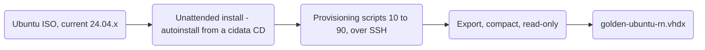
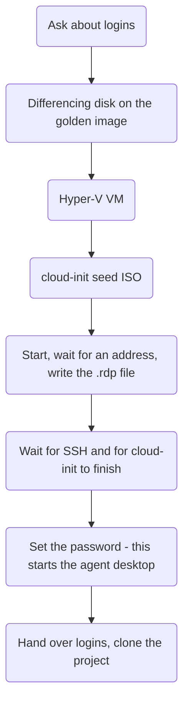
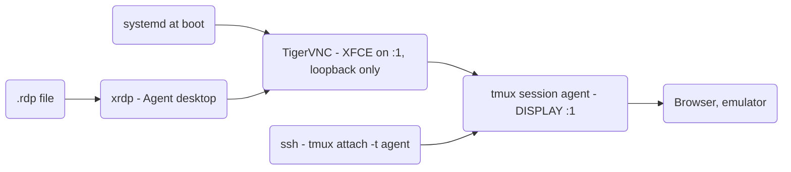

# agent-vm: design

<details>
<summary>✦ Written with AI assistance</summary>

The setup, the design decisions and the testing on my own machine are my own. An AI assistant (Claude Code) helped
me with research, writing the scripts, and drafting and editing the text.
</details>

This document describes how agent-vm works and why it is built the way it is: the host, the golden image and how it
is built, what is inside it, how a VM is created, the desktop the agent runs on, logins and passwords, the Android
emulator, and the things that fail in ways that do not look like their cause. How to use the scripts is in the
[README](README.md).

The scripts are the source of truth. If this document and a script disagree, the script wins, and this document
needs fixing.

## 1. Goals and constraints

I wanted to run several Claude Code agents in parallel, each on its own project, unattended, without any of them
being able to touch my development machine or each other. At the same time I wanted to be able to look at what an
agent is doing at any moment, including the browser or the Android emulator it drives.

| Item | Decision |
| --- | --- |
| Host | Windows 11 Pro, AMD Ryzen, 64GB RAM, my own hardware |
| Hypervisor | Hyper-V, which is part of Windows 11 Pro |
| Guest | Ubuntu 24.04 LTS Server with XFCE |
| Per VM | One project, one agent in a tmux session, a desktop that exists from boot, an Android emulator on demand |
| Watching | RDP onto the agent's own desktop, lossless; adb screenshots for exact pixel checks |
| Provisioning | A Packer golden image, a differencing disk per VM, a cloud-init seed, and everything secret over SSH |
| Isolation | One VM per project: its own disk, adb, ports, repository and agent login |

### Why Linux guests and not Windows guests

- The Android emulator uses KVM directly inside the guest. That is one thin virtualization layer, instead of
  Hyper-V inside Hyper-V.
- Ubuntu with XFCE idles at well under 1GB. On a fresh VM of mine the whole guest used 0.9GB with the desktop
  running. A Windows guest needs several GB and a licence before it does anything.
- Everything in the agent loop, adb, the shell, SSH, cloud-init and Claude Code, is native to Linux and scriptable.
- A new VM is a differencing disk and a cloud-init seed, not a Windows installation.

### Why not a lighter desktop or another distribution

The desktop is not what uses the memory. XFCE takes around 200MB of the guest. The emulator takes 2 to 4GB, a
browser 1 to 2GB, and builds whatever they need. Ubuntu LTS has the best Hyper-V guest support, it is what
Playwright supports officially, and an LTS release does not change underneath an unattended loop. A tiling Wayland
desktop such as Hyprland would be a poor fit: it expects a GPU, which a Hyper-V guest does not have, and xrdp is
built on X11.

## 2. The host

### Hyper-V and the network switch

Hyper-V and the Windows Hypervisor Platform are enabled as Windows features. AMD-V (or VT-x) must be on in the BIOS,
because the emulator needs nested virtualization.

All VMs use an **external** switch called `DevSwitch`, bound to the host's network adapter. Each VM therefore gets
an address from my router, and I can reach it with SSH and RDP directly. Please note, this also means that every
other device on the local network can reach port 22 and 3389 of every VM. That is the reason SSH accepts keys only
and the desktop is behind a password, even though I never type it (section 7).

### Storage layout

```
<Root>\golden\golden-ubuntu-rn.vhdx     the golden image, read-only
<Root>\golden\build\                    Packer's output during a build, deleted afterwards
<Root>\vms\<Name>\disk.vhdx             the VM's differencing disk; its parent is the golden image
<Root>\vms\<Name>\seed.iso              the cloud-init seed, attached for the life of the VM
<Root>\vms\<Name>\Virtual Machines\     Hyper-V's configuration
.\<Name>.rdp                            written where New-AgentVM.ps1 was run
```

`<Root>` is `$env:AGENTVM_ROOT`, or `C:\Hyper-V` when it is not set. Every script takes `-Root`, and every other path
derives from it, so the whole tree can move to another drive with one environment variable. The image name still
carries "rn" from where this started: parallel React Native development.

### Tools on the host

Packer builds the image. `oscdimg` from the Windows ADK writes the seed ISOs, both the one Packer uses during the
build and the one for each VM. The OpenSSH client that ships with Windows does everything after a VM has booted.
`gh` and the Claude Code CLI are optional, and only needed to hand logins over to a VM. Windows PowerShell 5.1 runs
all scripts; PowerShell 7 is not needed.

## 3. Building the golden image

`packer/Build-GoldenImage.ps1` wraps Packer. It checks the prerequisites, resolves the Ubuntu ISO, runs
`packer init`, `packer validate` and `packer build`, and then moves the exported VHDX to its final place, compacts
it with `Optimize-VHD`, marks it read-only and deletes the build directory. A build takes 30 to 50 minutes.



### The unattended install

Packer's `hyperv-iso` builder creates a Generation 2 VM with 4 vCPUs, 8GB of static memory and a 60GB dynamic disk.
Secure Boot is off. Nested virtualization is on, because the emulator boots inside the build VM later, and Hyper-V
then requires dynamic memory to be off. Without both, the build runs for 40 minutes and then fails on a missing
`/dev/kvm`.

The install itself has no manual step. `packer/http/user-data.pkrtpl.hcl` answers every question of Ubuntu's
installer in advance, and Packer writes it onto a second CD labelled `cidata`, where cloud-init finds it by its
label. The only thing typed into the VM are three lines at the GRUB prompt, which put `autoinstall` on the kernel
command line:

```
linux /casper/vmlinuz autoinstall ---
initrd /casper/initrd
boot
```

Hyper-V's virtual keyboard drops keystrokes when they come too fast, and a mistyped `autoinstal` is silently ignored
by the kernel. The template therefore waits 250ms between key groups, and `Build-GoldenImage.ps1 -KeyInterval`
slows the typing further.

The autoinstall configuration:

| Setting | Value | Why |
| --- | --- | --- |
| Storage | `direct`, the whole disk, no LVM | LVM caps the root volume and leaves most of the disk unused |
| Network | DHCP on `en*` and `eth*` | Hyper-V's network adapter comes over VMBus without a PCI slot, so it stays `eth0`. Matching `en*` alone takes the network down in the middle of the install |
| User | `dev`, passwordless sudo through `/etc/sudoers.d/90-dev` | |
| SSH | key only (`allow-pw: false`), the host's `~/.ssh/id_ed25519.pub` | |
| Password | the hash of `devvm` | Only for the Hyper-V console while a build hangs; locked before export (section 7) |
| Packages | `openssh-server`, `curl`, `ca-certificates`, `unzip`, `python3`, `linux-cloud-tools-virtual` | |

`linux-cloud-tools-virtual` is not optional. It provides `hv_kvp_daemon`, which is how the guest reports its address
back to Hyper-V. Without it, Packer and `New-AgentVM.ps1` both wait out their timeouts for a VM that was reachable the
whole time.

If the installer shows its own screens (language, keyboard, disk) instead of a scrolling log, the build has already
failed. One of three things went wrong, and in the VM's console (`Ctrl+Alt+F2`) one command each tells which:

```bash
cat /proc/cmdline               # must contain "autoinstall"; if not, GRUB dropped keystrokes
blkid -L cidata                 # must name a device; if not, Packer built no seed (no oscdimg)
sudo cloud-init status --long   # must not say "Failed loading yaml blob"
```

The third one is the treacherous one. cloud-init reads the configuration as one document, so a single malformed
line discards all of it, the installer finds no `autoinstall` section and starts asking questions. The usual cause
is a shell command containing `: ` written as a bare YAML value, which YAML reads as a mapping. All commands in the
template are therefore quoted, and the Packer template decodes the rendered document with `yamldecode()`, so
`packer validate` rejects a broken one within a second instead of 20 minutes into a build.

### The provisioning scripts

Once the installed system answers on SSH, Packer runs the scripts in `packer/scripts/` in order, as `dev`:

| Script | Installs |
| --- | --- |
| `10-desktop-xrdp.sh` | System upgrade, XFCE, xrdp, TigerVNC, the agent desktop, tmux and shell tools |
| `20-node-java.sh` | Node (NodeSource), SDKMAN with Temurin 21 and 17, the C/C++ toolchain, watchman |
| `25-ide-browser.sh` | VS Code, the GitHub CLI, Google Chrome with the Claude extension, Chromium, Playwright |
| `30-android-sdk.sh` | The Android SDK, a system image, the `dev` AVD, `~/bin/emu`, `adb-bridge.service` |
| `40-emulator-snapshot.sh` | Boots the AVD once and saves the `golden` snapshot |
| `50-claude.sh` | Claude Code, its VS Code extension, the `mobile` MCP server, the global `CLAUDE.md` |
| `90-cleanup.sh` | Generalizes the disk so it can be cloned (section 3, "Generalization") |

All of them pass apt settings as arguments to `sudo` (`DEBIAN_FRONTEND=noninteractive`), because `sudo` resets the
environment and an exported variable never reaches apt.

### Versions: the newest of everything, on purpose

Every build is meant to ship the newest version of everything. A disposable image is upgraded by rebuilding it, so
the defaults resolve "newest" at build time instead of naming versions:

| Component | Resolved as |
| --- | --- |
| Ubuntu ISO | the highest 24.04.x in the published `SHA256SUMS`, read by `Build-GoldenImage.ps1` |
| Ubuntu packages | `apt-get upgrade` |
| Node | the newest of the major in `node_major` (22) from NodeSource |
| JDKs | the newest Temurin of each major in `jdk_majors` (`21 17`), from `sdk list java` |
| Android API | the newest API that has a `google_apis;x86_64` system image |
| Android build-tools | the newest stable release whose major is not above that API |
| cmdline-tools, platform-tools, emulator | `latest` from `sdkmanager` |
| VS Code, GitHub CLI, Chrome, Chromium | their stable apt channels (Chromium falls back to the snap) |
| Playwright and its browsers | `npm install -g @playwright/test`, then the browsers that version pins |
| Claude Code and its VS Code extension | npm and the Marketplace |
| `mobile` MCP server | `npx ... @latest`, resolved again every time an agent starts it |

Two consequences are worth naming, since neither is a bug: two builds from the same commit are different images,
and the MCP server is not versioned by the image at all.

Three places take the newest version that works rather than the newest that exists. Google publishes a new
`platforms;android-NN` before the matching emulator image, so the API is chosen by system image; otherwise the AVD
cannot be created twenty minutes into the build. Release candidates and preview platforms are excluded. And
build-tools are capped at the chosen API, because the next build-tools major appears long before its platform.

Every resolution is also a Packer variable, so pinning one is a flag rather than an edit, for example
`-var android_api=35`, `-var node_major=24` or `-var jdk_majors="21"`. The Ubuntu ISO is pinned through the wrapper:
`-UbuntuSeries`, or `-IsoUrl` with `-IsoChecksum`. Since the versions are a property of the build date, the build log
is the only record of them; each script prints a `==> versions` block at the end.

### Generalization

`90-cleanup.sh` decides whether cloning works at all. Anything machine-specific left on the disk is copied into
every VM.

| Removed or reset | Why |
| --- | --- |
| `/etc/machine-id`, truncated but not deleted | systemd generates a new one into an existing empty file. Two VMs with the same id share a DHCP identity and take turns getting the same address |
| `/etc/ssh/ssh_host_*` | cloud-init generates new ones on first boot; otherwise all VMs have the same identity |
| `dev`'s password, locked | `devvm` is published in this repository (section 7) |
| cloud-init state (`cloud-init clean --logs --seed`) | Otherwise cloud-init believes it has already run, and ignores the VM's seed |
| apt lists and caches, logs, journal, `/var/tmp`, bash history | Size |
| AVD lock files and `snapshots/default_boot` | Live emulator state would resume into a stale session; `snapshots/golden` is what is kept |
| `~/.android/cache`, `adbkey`, `adbkey.pub` | The adb identity is per machine |

The cleanup also pins cloud-init to the NoCloud datasource (`datasource_list: [NoCloud, None]`), so a VM only looks
for its seed ISO instead of probing every cloud. This happens here and not in the autoinstall on purpose: pinned
earlier, it redirects the installer's own first boot to the autoinstall CD, which creates no user, and the image
ends up without a `dev` account. Finally `fstrim` zeroes the free space, so `Optimize-VHD` can compact the disk.

### Upgrading

A VM's disk is a differencing disk: it only holds what changed, and reads everything else from the golden image. The
golden image must therefore never change while a VM uses it. An upgrade is a new image with a new name, and the old
one is deleted when its last VM is gone. `Build-GoldenImage.ps1` refuses to overwrite an image that still has
children, and `Remove-AgentVM.ps1` refuses to delete a disk that is another VM's parent.

## 4. What is in the image

### Base system and desktop

Ubuntu 24.04 Server with the `xfce4` metapackage, which brings the session, window manager, panel, desktop, settings
and Thunar, but not the full Xubuntu application set and no display manager. xrdp starts XFCE from `~/.xsession`;
the agent desktop starts it through TigerVNC (section 6). `light-locker` is removed, and `xfce4-screensaver` and
`gnome-screensaver` are hidden in autostart, because a locked screen hides the agent from whoever is watching. A
polkit rule approves the colour manager's actions, which would otherwise put a password prompt on a desktop with
nobody at the console.

### Languages and build tools

| Component | Source |
| --- | --- |
| Node.js and npm | NodeSource apt repository, major `node_major` |
| Temurin JDK 21 (default) and 17 | SDKMAN, installed for `dev` in `~/.sdkman` |
| `build-essential`, `cmake`, `ninja-build`, `pkg-config`, `python3-dev` | Ubuntu |
| watchman | The newest GitHub release with a Linux build, best effort |

The JDKs come from SDKMAN rather than Ubuntu's packages, so a VM can add or switch a major itself (`sdk install java
25-tem`) without root and without a new image. 21 is the default because Capacitor 7 compiles at Java 21; 17 is
there for projects whose Gradle is older than 8.5.

SDKMAN only hooks into interactive shells. Two things make Java available elsewhere, both pointing at SDKMAN's
`current` link so `sdk default java` stays the one place the version is decided: `/etc/profile.d/java.sh` exports
`JAVA_HOME` and `PATH`, and `java`, `javac`, `jar`, `jarsigner` and `keytool` are linked into `/usr/local/bin`.
`JAVA_HOME` is set explicitly because the React Native and Capacitor command line tools read the variable and do not
fall back to `PATH`.

The C/C++ toolchain is needed although no `package.json` names it. `node-gyp` compiles the native parts of ordinary
npm packages, and React Native's Android build compiles Hermes with CMake and Ninja. Without it, `npm install` or the
first Gradle build fails on a missing compiler, deep in output that does not say so. watchman is optional for Metro,
and its Linux build is only published for some releases, so a failed download warns and the build goes on.

### Editor and browsers

- **VS Code** from Microsoft's apt repository, and `xdg-utils`, without which "open in browser" and clicking a link
  in the terminal silently do nothing.
- **GitHub CLI** from GitHub's apt repository, logged into nothing.
- **Google Chrome** from Google's apt repository, with the **Claude in Chrome** extension force-installed through a
  managed policy (`/etc/opt/chrome/policies/managed/claude-in-chrome.json`). Chrome downloads the extension on its
  first start.
- **Chromium** for general web work, from apt with the snap as fallback.
- **Playwright**, installed globally, with the Chromium, Firefox and WebKit builds in `~/.cache/ms-playwright`.

Chrome is there as well as Chromium because Claude Code talks to the extension through a native messaging host,
which the Chromium snap does not allow. Claude Code writes that host's manifest itself the first time `claude
--chrome` runs, so nothing about it is in the image.

### Android

The SDK is in `~/Android/Sdk` with cmdline-tools, platform-tools (adb), the emulator, one platform, its build-tools
and the `google_apis;x86_64` system image. All licences are accepted during the build. The emulator's libraries are
installed explicitly, and `dev` is in the `kvm` group. One library is easy to miss: `libxcb-cursor0`. Without it a
windowed emulator dies with "no Qt platform plugin could be initialized", a message that names the plugin and not
the package.

The `dev` AVD is a Pixel 6 with 4GB of RAM, a 6GB data partition and the SwiftShader software renderer. There is no
GPU in a Hyper-V Linux guest, so software rendering is the only option, and it renders app interfaces accurately.

`40-emulator-snapshot.sh` boots the AVD once, waits until Android has finished booting and the boot animation has
stopped, waits another 30 seconds so the snapshot is not taken in the middle of Android's own first-boot work,
switches off all animations, and saves the snapshot `golden`. A VM resumes it in seconds instead of 60 to 90 seconds
for a cold boot. Section 8 covers how it is started.

### Agent tooling

- **Claude Code** (`npm install -g @anthropic-ai/claude-code`) and its **VS Code extension**, installed as `dev`
  because extensions are per user.
- The **`mobile` MCP server**, registered for the user. Driving the app through `tap_element` and
  `list_elements_on_screen` is far more reliable than `adb shell input tap` at coordinates the agent guessed.
- **`~/.claude/CLAUDE.md`** with the conventions of the machine: where the project is (`~/app`), how to start the
  emulator, the screenshot verification loop, and that long-running processes belong in tmux.
- **`~/shots/`** for screenshots.

### Environment, services and home directory

`/etc/profile.d/android.sh` and `/etc/profile.d/java.sh` set `ANDROID_HOME`, `JAVA_HOME` and the `PATH`. Please note,
only login shells read them. A command passed to `ssh vm '...'`, to `tmux new-window` or to a desktop autostart entry
does not, which is why `~/bin/emu` loads the Android profile itself and Java is linked into `/usr/local/bin`.

| Service | Port | Purpose |
| --- | --- | --- |
| `ssh` | 22 | key only |
| `xrdp` | 3389 | RDP onto the agent desktop, or a separate desktop per login |
| `tigervncserver@:1` | 5901, loopback only | the agent desktop; skipped until the VM has its password |
| `adb-bridge` | 5555, LAN address only | makes a running emulator reachable from the host |

```
~/app/                          the project; the agent's working directory
~/Android/Sdk/                  the Android SDK
~/.android/avd/dev.avd/         the AVD, with snapshots/golden
~/bin/emu                       starts the emulator
~/.claude/CLAUDE.md             the agent's conventions for this machine
~/.vnc/config, ~/.vnc/passwd    the agent desktop's settings, and its password (per VM, not in the image)
~/.config/autostart/            agent terminal, no screen blanking, hidden screensavers, optionally the emulator
~/shots/                        screenshots
```

### What is deliberately not in the image

No password that works, no project, no npm or Gradle cache, and no login of any kind: no GitHub token, git identity
or `known_hosts` entry for GitHub, and no Claude login. The image is shared by every VM, so anything secret in it
would be handed to all of them. Logins reach one VM at a time, after it has booted (section 7).

The finished image on my host is 24.4GB, compacted. A VM's own disk starts near zero and grows with what the project
writes.

## 5. Creating a VM

`New-AgentVM.ps1` does everything that makes a VM out of the golden image. It first asks whether to hand over my
GitHub and Claude logins, so that the rest runs without interruption, then builds the VM.



### The VM itself

| Setting | Why |
| --- | --- |
| Differencing disk on the golden image | A new VM in seconds, costing only what it writes |
| Generation 2, Secure Boot off | Like the image it was built as |
| Static memory, 10GB (6GB with a phone) | Hyper-V does not allow dynamic memory with nested virtualization |
| 4 vCPUs, virtualization extensions exposed | KVM for the emulator inside the guest |
| MAC address spoofing on | Part of Hyper-V's usual setup for nested virtualization |
| Checkpoints off | Not supported together with nested virtualization |
| Automatic start: nothing; automatic stop: shut down | VMs only run when I start them |
| Boot order: disk first | Adding the seed's DVD drive would otherwise take over the boot order |

Since VMs do not start with the host, an agent does not resume after the host restarts until I start its VM again.

### The cloud-init seed

The seed is a small ISO with `user-data` and `meta-data`, labelled `CIDATA`, which cloud-init's NoCloud datasource
finds by its label. It sets the hostname, the `dev` user with my SSH key and passwordless sudo, writes `~/.env` with
the project name and the adb settings, and creates `~/app`. With `-StartEmulator` it also writes the emulator's
autostart entry.

The seed contains nothing secret, and that is the central rule of the design: **the ISO stays attached to the VM for
its whole life, and anything running inside the VM can read it.** No password, token or key goes on it. The
templates are rendered with LF line endings and without a byte order mark, because cloud-init reads a `\r` at the end
of a command as part of the command.

Each `runcmd` entry is written as a YAML list rather than a plain string. A plain string containing `: ` is read as
a mapping, cloud-init's `runcmd` module fails on it, and every other entry goes down with it, while the VM answers
SSH and looks healthy.

### First boot and every boot

cloud-init applies the seed on the **first boot only**. Anything that must be running after every boot therefore
belongs in systemd or in the desktop's autostart, never only in the seed. In an earlier version, the agent's tmux
session and the emulator were started from `runcmd`, and after the first reboot of the VM neither existed any more.

| Started by | When | What |
| --- | --- | --- |
| cloud-init | first boot | hostname, user, SSH key, `~/.env`, `~/app` |
| `Set-AgentVMPassword.ps1` over SSH | once, at creation | password, and the first start of the agent desktop |
| systemd | every boot | SSH, xrdp, the agent desktop, `adb-bridge` |
| the agent desktop's autostart | every boot | the agent's tmux session, and with `-StartEmulator` the emulator |

### After boot, over SSH

When the VM has an address, the script waits until SSH answers and `cloud-init status --wait` returns, removes a
stale `known_hosts` entry for that address (DHCP hands addresses to new VMs, and SSH would then refuse to connect),
and then:

1. Sets the RDP password through `Set-AgentVMPassword.ps1`, which also starts the agent desktop.
2. Copies a setup script to `/tmp/agentvm-setup.sh` in the guest, and pipes the accepted logins to it on standard
   input (section 7).
3. With `-Repo`, clones the project into `~/app` with `gh repo clone` (plain `git clone` for other hosts) and runs
   `npm install`. If the GitHub login was not handed over, it offers an interactive `gh auth login` in the guest
   instead.

The setup script stays in `/tmp`, so a declined or failed step can be finished later with the command the script
prints.

### The .rdp file

The `.rdp` file is written with lossless settings: 32-bit colour, no compression, no smart sizing and 100% scaling,
so one pixel of the guest is one pixel on my screen. Together with the password in Credential Manager it opens the
agent desktop without a dialog.

The agent desktop has a fixed size, 1920x1080 unless `-RdpResolution` says otherwise, and refuses to be resized
(`AcceptSetDesktopSize=0`, section 6). Without that, xrdp resizes it to whatever size the client asks for and keeps
that size after the client disconnects, so a full-screen connection from a 4K monitor would leave the agent working at
3840x2160. The `.rdp` file therefore opens a window of exactly that size: mstsc opened full screen always asks for the
monitor's size, and xrdp would draw the desktop into a corner of a 4K frame. With smart sizing on and dynamic
resolution off, maximizing the window or choosing **Full screen** from its window menu (Ctrl+Alt+Break) scales the
1920x1080 picture up instead, exactly 2x on a 4K screen. At the window's own size it is still one pixel for one.

## 6. The agent desktop and remote access

### The problem

An xrdp login normally creates a **new** X display for that login, and it is gone again when the user logs out.
Anything started before it, a tmux session opened at boot or over SSH, has no display at all. A headed browser
launched from there either fails with "Missing X server or $DISPLAY", or Playwright quietly runs it headless. Either
way there is nothing to watch. The Hyper-V console window does not help either: the guest has no display manager, so
the console only shows a text login.

### The solution: one desktop from boot

Each VM runs one XFCE desktop on display `:1` under TigerVNC, as `dev`, started by systemd at every boot whether or
not anyone is connected. It only listens on the VM's loopback interface. The desktop's autostart opens a maximized
terminal attached to the tmux session `agent`, so that session, and everything started from it, has `DISPLAY=:1`. A
browser or the emulator the agent starts therefore appears on that desktop.

xrdp gets an additional session type, **Agent desktop**, listed first. It uses xrdp's VNC module to connect RDP to
the existing display instead of creating one. The usual **Xorg** session stays available as a fallback.



Closing the RDP window leaves the desktop, the agent and its browser running. tmux runs as its own server process, so
the agent even survives a restart of the desktop. `ssh dev@<vm-ip> -t tmux attach -t agent` is a second view of the
same session.

The pieces:

| Piece | Purpose |
| --- | --- |
| `/etc/tigervnc/vncserver.users` | `:1=dev` |
| `~/.vnc/config` | XFCE, 1920x1080 by default (`-RdpResolution` rewrites it on first boot), `AcceptSetDesktopSize=0` so RDP cannot resize it, loopback only, VNC password |
| `tigervncserver@:1.service.d/10-agent-vm.conf` | `ConditionPathExists=/home/dev/.vnc/passwd`, so the unit is skipped, not failed, until the VM has a password |
| `[Agent]` in `/etc/xrdp/xrdp.ini` | `libvnc.so` to `127.0.0.1:5901`, before `[Xorg]` |
| `~/.config/autostart/agent-terminal.desktop` | `xfce4-terminal` running `tmux new-session -A -s agent -c ~/app` |
| `~/.config/autostart/no-blanking.desktop` | `xset s off`; a blank screen hides the agent |

The tmux session is an empty shell when the VM starts. The agent is started in it by me, or later by a loop runner.

### Lossless colour

The desktop exists for visual checks, and a colour read off a compressed frame is meaningless. xrdp is set to 32 bits
per pixel with bitmap and bulk compression off and the lossy codecs disabled, and the `.rdp` file asks for the same.
For an exact value, a PNG screenshot is still the reference (section 9).

## 7. Logins and passwords

### SSH

SSH accepts my key only (`allow-pw: false`), for the `dev` user, who has passwordless sudo. Every automated step
after boot goes over SSH with that key, which is why nothing secret ever has to be in the image or on the seed.

### The RDP password

| Question | Answer |
| --- | --- |
| Who sets it | `Set-AgentVMPassword.ps1`, over SSH. `New-AgentVM.ps1` calls it for the first password |
| Where it is in the guest | the Unix password (`chpasswd`) and the agent desktop's VNC password (`~/.vnc/passwd`) |
| Where it is on the host | only in Windows Credential Manager, encrypted for my Windows user |
| Under which names | `TERMSRV/<address>`, which mstsc uses for the `.rdp` file, and `agent-vm:<Name>`, which survives an address change and is what `Get-AgentVMPassword.ps1` reads |
| How long | at most 8 characters |

The limit of 8 comes from VNC authentication, which ignores everything after the 8th character. A longer password
would only look stronger, so the scripts do not accept one. The VMs are only reachable on my local network, and I
never type the password, since mstsc sends it from Credential Manager and xrdp passes it on to the VNC check.

Changing the password does not restart the desktop. TigerVNC's session starter copies `~/.vnc/passwd` to a file under
`/tmp` when the desktop starts, but Xvnc reads that copy again on every connection. `Set-AgentVMPassword.ps1`
overwrites both, so the next connection uses the new password while the agent keeps running. On a new VM, where the
desktop could not start without a password, it starts it.

Two details of passing the password over SSH: it goes on standard input, never on a command line, so it appears in
no process list. And the guest strips both the `\r` that PowerShell appends to piped text, and the UTF-8 byte order
mark that Windows PowerShell puts in front of it when the console is set to UTF-8. Without the latter, `chpasswd`
looks for a user called "<BOM>dev" and fails with "Authentication token manipulation error".

Earlier versions put the password on the seed ISO and wrote changes to a plain text file next to it.
`Get-AgentVMPassword.ps1` still reads both for VMs created that way.

### The build password

The image is installed with the password `devvm`, so that a hung build can be debugged at the Hyper-V console. It is
published in this repository, so it must not survive into the image: every VM cloned from it would have `dev`/`devvm`
with passwordless sudo behind RDP. `90-cleanup.sh` locks it before the image is exported. Locking does not affect
anything that comes after: SSH still accepts the key for a locked account because Ubuntu runs sshd with
`UsePAM yes`, and sudo is passwordless.

### GitHub and Claude

Before it builds the VM, `New-AgentVM.ps1` offers two logins, each with its own question and its own `-Skip` switch:

- **GitHub**: the token `gh` holds on the host, plus my global git name and email. In the guest the setup script runs
  `gh auth login --with-token`, `gh auth setup-git` and `git config --global`. The VM then shares the host's token:
  revoking it logs out both. Without it, the script offers an interactive `gh auth login` in the guest, which gives
  the VM a token of its own.
- **Claude**: a long-lived token for my Claude subscription from `claude setup-token`, not an API key, so nothing is
  billed per token. It is cached in `~\.agent-vm\claude-oauth-token`, readable by my account only, and written into
  the guest's `~/.claude/settings.json` as `CLAUDE_CODE_OAUTH_TOKEN`, which logs in both the CLI and the VS Code
  extension. Without it, `/login` once per VM does the same.

Both reach the guest on standard input over SSH, after boot, never on the seed. They exist in exactly two places:
the host and that one VM.

## 8. Android

### The emulator on demand

The emulator holds 2 to 4GB of RAM while it runs. On one of my VMs, memory use went from 0.8GB to 5.8GB when it
started. A web-only project does not need it, so by default nothing starts it. The agent starts it when a task needs
it, as its `CLAUDE.md` tells it to, from its tmux session, and it opens as a window on the agent desktop:

```bash
tmux new-window -d -n emu '~/bin/emu -snapshot golden'
```

A VM created with `-StartEmulator` gets an autostart entry on the agent desktop instead, written by cloud-init, and
the emulator starts with the desktop at every boot. `-DeviceSerial` creates a VM without an emulator at all.

`~/bin/emu` wraps the emulator with the image's settings (`-avd dev -gpu swiftshader_indirect -no-boot-anim
-no-audio -no-snapshot-save -port 5554`) and handles two traps for its callers:

- It adds `-no-window` when `DISPLAY` is not set. Started with a window but without a display, the emulator dies at
  once on the Qt platform plugin, and whatever started it waits for a device that never appears.
- It loads `/etc/profile.d/android.sh` when `emulator` is not on the `PATH`. Without that, a command from
  `tmux new-window`, an autostart entry or a plain SSH command fails with `exec: emulator: not found`.

`-no-snapshot-save` keeps the `golden` snapshot unchanged, so every start resumes the same clean state.

Each start shows an info dialog about nested virtualization. It does not block adb, but it stays on the desktop
until someone closes it.

### Reaching the emulator from the host

The emulator binds its adb port 5555 to the guest's loopback interface only, and has no option to change that.
`adb-bridge.service` republishes it on the VM's network address with socat, so `adb connect <vm-ip>:5555` works from
the host for Android Studio or scrcpy.

The bridge binds the network address, never `0.0.0.0`. Binding all interfaces includes loopback: socat's listener
then answers its own forwarding target, and with `fork` every connection spawns another one without end. At the
same time it takes `127.0.0.1:5555` away from the emulator. I saw both on a real VM. The address comes from DHCP and
is read when the service starts, so after an address change the bridge needs a restart.

`adb tcpip 5555` looks like the fix and is not. It switches Android's adbd to TCP behind the emulator's own NAT,
which the host still cannot reach, and it disconnects the emulator from the VM's adb server, after which
`adb exec-out screencap` silently writes empty files.

### Physical phones

For a game or anything that needs a real GPU, a physical phone replaces the emulator. Hyper-V does not pass USB
through to Linux guests, so the phones stay on the host, and adb bridges the gap:

```
[phones] --USB--> [host: one adb server on port 5037] <--TCP-- [VM 1] [VM 2] ... [VM n]
```

On the host, one adb server listens on all interfaces (`adb -a -P 5037 nodaemon server`), and the firewall allows
port 5037 from the VMs' subnet. This host side is not scripted. A VM created with `-DeviceSerial <serial>
-HostIp <host-ip>` gets `ADB_SERVER_SOCKET=tcp:<host-ip>:5037` and `ANDROID_SERIAL=<serial>` in `~/.env`, so adb, the
React Native tools and the MCP server in that VM all use exactly that one phone. It needs no emulator, so it gets
6GB instead of 10GB.

## 9. Visual verification

From most to least exact:

1. **PNG screenshots through adb.** `adb exec-out screencap -p` is a lossless copy of the frame buffer. Viewed at
   100% with an eyedropper it gives exact colours, and pixels divided by the density (`adb shell wm density`) give dp.
   From PowerShell, use `screencap` to a file on the device and `adb pull`; PowerShell's `>` re-encodes the bytes as
   text and the result is not a PNG.
2. **RDP onto the agent desktop**, lossless as described in section 6.
3. **React Native's element inspector**, which shows the computed margins, paddings and font sizes of an element.
4. **Android Studio's Layout Inspector** on the host, through `adb connect`.
5. **scrcpy**, leaner than RDP, and the best view of a physical phone.

## 10. Capacity

On my 64GB host I keep about 12GB for Windows, which leaves room for about five VMs with 10GB each running at the
same time, or about eight with physical phones. Memory is static, so a VM holds its full allocation while it runs,
whether or not the emulator is up. CPUs can be overcommitted: agents spend most of their time waiting for the model,
and 5 x 4 vCPUs on a 16-core Ryzen is comfortable. I keep more VMs than that created, and only start the ones I work
on; a stopped VM resumes with its disk intact.

## 11. Removing a VM

`Remove-AgentVM.ps1` shuts the VM down gracefully, turns it off after 60 seconds, removes any checkpoints, removes
the VM from Hyper-V, and deletes its folder, its `.rdp` file and both of its Credential Manager entries. The
`TERMSRV` entry matters: DHCP may give the address to the next VM, and a stale entry would log in to it with this
VM's password.

It refuses to touch a disk that is not a differencing disk inside the VM's folder, or that another VM uses as its
parent, because such a disk may hold data that exists nowhere else.

## 12. Things that fail in a way that does not look like their cause

| Symptom | Cause |
| --- | --- |
| The installer asks questions | The build has already failed; see section 3 |
| Packer waits for SSH forever, the VM shows a login prompt | `hv_kvp_daemon` missing, so Hyper-V never learns the address |
| The install dies at `retrieving: unzip` | The network matched `en*` only; Hyper-V's adapter is `eth0` |
| Two VMs get the same address | `/etc/machine-id` was not empty; the image was booted again after the cleanup |
| A VM ignores its seed: no user, no key | cloud-init state was left in the image, or the datasource pin came too early |
| cloud-init "finished", but half of `runcmd` did not run | A `runcmd` entry was a plain string containing `: ` |
| A browser the agent opens does not appear over RDP | It was started outside the agent desktop, with no `DISPLAY` |
| The tmux session or emulator is gone after a reboot | It was started from cloud-init, which only runs on the first boot |
| `exec: emulator: not found` | A non-login shell, without the Android `PATH` |
| A windowed emulator dies on "no Qt platform plugin" | No display, or `libxcb-cursor0` missing |
| `adb connect <vm-ip>:5555` is refused | `adb-bridge` is not running, or the VM's address changed |
| Thousands of `socat` processes | The bridge was bound to `0.0.0.0` |
| `adb exec-out screencap` writes 0 bytes | Someone ran `adb tcpip 5555`; restart the VM's adb server |
| `chpasswd`: "Authentication token manipulation error" | A byte order mark in front of the piped text |
| The `.rdp` file asks for a password | No Credential Manager entry for the VM's current address; run `Set-AgentVMPassword.ps1` |
| SSH: "REMOTE HOST IDENTIFICATION HAS CHANGED" | DHCP gave a new VM an old address; `ssh-keygen -R <ip>` |
| Colours look close, but not exact over RDP | A lossy codec; compare against a PNG |

## 13. Alternatives considered

**A Linux host.** If the host operating system were negotiable, Proxmox or Ubuntu with KVM would be the stronger
platform: no nested virtualization, emulators in containers sharing the host's `/dev/kvm`, roughly twice the emulator
density on the same hardware, and a real GPU for the emulators. The provisioning approach, a golden image, a clone and
cloud-init, would carry over unchanged. I keep Windows as the host because it is also my development machine.

**GPU for games.** Hyper-V offers Linux guests no practical way to a GPU: GPU partitioning targets Windows guests,
and device assignment is Windows Server only. WSL2 with its D3D12 driver would be a one-hour experiment at most.
Physical phones are the answer for games, and if that part grows, a Linux host is the point to revisit.

**An API key per VM, put there by cloud-init.** Billed per token instead of using my subscription, and it would be
on the seed ISO, readable inside the guest.
