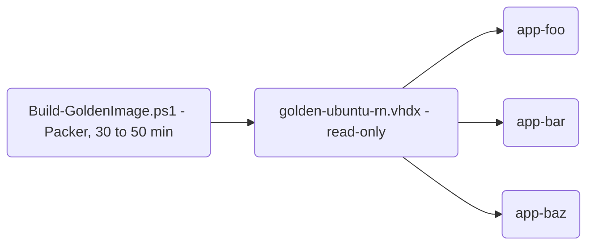

# agent-vm

Disposable Ubuntu VMs on a Windows 11 Hyper-V host, built for running Claude Code agent loops in isolation while
I can still watch what the agent is doing over Remote Desktop.

I run my agents unattended for hours. Doing that on my development machine means every loop has to tiptoe around
my working tree, and a session with `--dangerously-skip-permissions` is a risk to everything on the disk. Giving
each project its own VM removes both problems: the agent can do whatever it wants inside the guest, and the worst
case is that I delete the VM and create a new one in about two minutes.

This repo contains the scripts I use for that. The host is my Ryzen workstation with 64GB of RAM running Windows 11
Pro, and the guests run Ubuntu 24.04 LTS with XFCE. The sibling repo `runner-vm` does the same job with a Windows
guest, for the loops that have to run on Windows.

How all of it works, and why it is built the way it is, is described in [DESIGN.md](DESIGN.md). This file covers
what it is and how to use it.

## What you get

There are two stages. Packer builds a **golden image** once: an unattended Ubuntu install with the desktop, the
toolchains, the browsers, an Android emulator and Claude Code already in it. Every project then gets its **own VM**,
which is only a differencing disk on top of that image plus a small cloud-init seed. Creating one takes about two
minutes and costs only the disk space the project writes.



Each VM has:

- A desktop that exists from boot, whether or not anyone is connected. The agent runs in a tmux session on that
  desktop, so a browser or the emulator it opens appears where I can see it. Double-clicking the VM's `.rdp` file
  opens that desktop, without a password prompt.
- Node, Java (Temurin 21 and 17), the Android SDK and an emulator that starts from a snapshot in seconds.
- VS Code, Google Chrome with the Claude in Chrome extension, Chromium and Playwright with its browsers.
- Claude Code and the GitHub CLI. The script can log both in for me, over SSH, after the VM has booted.

It is worth mentioning that no credentials are part of the image or the seed, not even a password. Everything
secret reaches a VM over SSH after it has booted, and on the host the RDP password is only kept in Windows
Credential Manager.

## Requirements

- Windows 11 Pro with Hyper-V, and AMD-V or VT-x enabled in the BIOS. The emulator needs nested virtualization.
- About 70GB free for the image build, plus space for each VM's own disk.
- Windows PowerShell 5.1, which ships with Windows, run as Administrator for everything that touches Hyper-V.
- An SSH key pair at `~/.ssh/id_ed25519`. It becomes the login for every VM.

Optional: the GitHub CLI (`gh`) logged in on the host, so a VM can get my GitHub login, and the Claude Code CLI, so
a VM can get a Claude subscription token.

## Setting up the host

This is needed once. In an elevated PowerShell:

```powershell
Enable-WindowsOptionalFeature -Online -FeatureName Microsoft-Hyper-V -All
Enable-WindowsOptionalFeature -Online -FeatureName HypervisorPlatform
Restart-Computer
```

After the restart, create an external switch called `DevSwitch`, so each VM gets an address on the local network:

```powershell
Get-NetAdapter                                             # find the name of the network adapter
New-VMSwitch -Name DevSwitch -NetAdapterName "Ethernet"
```

Then install the tools and generate the SSH key if there is none yet:

```powershell
winget install HashiCorp.Packer
winget install Microsoft.WindowsADK          # Deployment Tools: oscdimg builds the cloud-init seed ISOs
winget install Google.PlatformTools          # optional: adb on the host, to reach a VM's emulator
ssh-keygen -t ed25519
```

Please note, winget only updates `PATH` for processes started afterwards. Open a new elevated shell before going on.

By default, images and VMs live under `C:\Hyper-V`. To use another drive, set `AGENTVM_ROOT` once and open a new
shell, or pass the same `-Root` to every script:

```powershell
[Environment]::SetEnvironmentVariable('AGENTVM_ROOT', 'E:\Hyper-V', 'Machine')
```

## Getting started

1. Build the golden image. It runs unattended and takes 30 to 50 minutes, most of it the Android system image
   download and the first boot of the emulator.

   ```powershell
   cd packer
   .\Build-GoldenImage.ps1
   cd ..
   ```

2. Create a VM for a project. Before it builds anything, it asks whether to hand over my GitHub and Claude logins.
   About two minutes later the VM is running, and the script has written `app-foo.rdp` into the current
   directory.

   ```powershell
   .\New-AgentVM.ps1 -Name app-foo -Repo you/foo
   ```

3. Open the `.rdp` file to see the agent desktop, or attach to the agent's tmux session over SSH. Both show the
   same session.

   ```powershell
   mstsc .\app-foo.rdp
   ssh dev@<vm-ip> -t tmux attach -t agent
   ```

4. Start the agent in that session (`claude`), and leave it to work. Closing the RDP window leaves everything
   running.

5. Stop the VM when it is not needed, and remove it when the project is done.

   ```powershell
   Stop-VM -Name app-foo
   .\Remove-AgentVM.ps1 -Name app-foo
   ```

## Daily use

**Connecting.** `mstsc .\app-foo.rdp` opens the **Agent desktop**. The password is in Credential Manager, so there
is no prompt. The xrdp dialog also offers an **Xorg** session, which is a separate desktop created for that one
login and is only a fallback.

**Passwords.** The RDP password is printed once when the VM is created. It has at most 8 characters, because VNC,
which guards the agent desktop, ignores everything after the 8th. I never type it anyway.

```powershell
.\Get-AgentVMPassword.ps1 -Name app-foo                 # read it back from Credential Manager
.\Get-AgentVMPassword.ps1 -Name app-foo | Set-Clipboard
.\Set-AgentVMPassword.ps1 -Name app-foo                 # generate a new one and apply it
```

**The Android emulator** is not running by default, because it holds 2 to 4GB of RAM. The agent starts it when a
task needs it, and it opens as a window on the agent desktop. By hand, in the guest:

```bash
tmux new-window -d -n emu '~/bin/emu -snapshot golden'   # a few seconds, from the golden snapshot
adb devices                                              # emulator-5554  device
adb emu kill                                             # stop it again
```

A VM created with `-StartEmulator` starts it with the desktop at every boot instead. From the host, a running
emulator is reachable with `adb connect <vm-ip>:5555`.

**Claude Code** is logged in at creation if I accepted the offer. Otherwise it is a one-off per VM:
`ssh dev@<vm-ip> -t claude`, then `/login`. Either way the login stays in that VM.

**A physical phone** instead of the emulator: create the VM with `-DeviceSerial <serial> -HostIp <host-ip>`, and
run one adb server on the host that all VMs use. [DESIGN.md](DESIGN.md) describes the host side.

## The scripts

All scripts take `-Root` (default `$env:AGENTVM_ROOT`, then `C:\Hyper-V`), and carry their full help:
`Get-Help .\New-AgentVM.ps1 -Full`.

| Script | Does | Elevated |
| --- | --- | --- |
| `packer\Build-GoldenImage.ps1` | Builds the golden image with Packer, then compacts and write-protects it | yes |
| `New-AgentVM.ps1` | Creates a VM from the golden image, sets its password, hands over logins, clones the repo | yes |
| `Remove-AgentVM.ps1` | Stops and deletes a VM, its files and its saved password | yes |
| `Get-AgentVMPassword.ps1` | Prints a VM's RDP password | no |
| `Set-AgentVMPassword.ps1` | Sets a new RDP password over SSH | only to look up the address |

### Build-GoldenImage.ps1

Run from `packer\`.

```powershell
.\Build-GoldenImage.ps1
.\Build-GoldenImage.ps1 -GoldenPath C:\Hyper-V\golden\golden-ubuntu-rn-2026-11.vhdx   # upgrade, side by side
.\Build-GoldenImage.ps1 -SkipBuild                                                    # only redo the post-steps
.\Build-GoldenImage.ps1 -KeyInterval 250ms                                            # GRUB keeps mistyping
.\Build-GoldenImage.ps1 -IsoUrl <url> -IsoChecksum sha256:<hex>                       # an exact Ubuntu ISO
```

| Parameter | Default | Meaning |
| --- | --- | --- |
| `-GoldenPath` | `<Root>\golden\golden-ubuntu-rn.vhdx` | Where the finished image lands. Must match `New-AgentVM.ps1 -GoldenVhdx` |
| `-BuildDirectory` | `<Root>\golden\build` | Packer's output, deleted afterwards |
| `-PackerDirectory` | the script's folder | Where `ubuntu-rn.pkr.hcl` is |
| `-SwitchName` | `DevSwitch` | Switch the build VM uses |
| `-VmName` | `golden-ubuntu-rn` | Name of the temporary build VM |
| `-OscdimgPath` | the Windows ADK path | Used when no ISO tool is on `PATH` |
| `-UbuntuSeries` | `24.04` | Series whose current point release is built |
| `-IsoUrl`, `-IsoChecksum` | resolved | Build an exact ISO instead |
| `-KeyInterval` | `100ms` | Delay per keystroke when typing the GRUB boot command |
| `-Replace` | off | Allow overwriting an image that has no VMs using it |
| `-Force` | off | Delete a VM left over from an interrupted build without asking |
| `-SkipBuild` | off | Only move, compact and protect an existing build output |

It refuses to overwrite an image that any VM still uses as its parent. An upgrade goes to a new file name.

### New-AgentVM.ps1

```powershell
.\New-AgentVM.ps1 -Name app-foo -Repo you/foo                          # offers my logins, then clones
.\New-AgentVM.ps1 -Name app-foo -Repo you/foo -SkipGitHubLogin -SkipClaudeLogin   # no prompts, ~/app stays empty
.\New-AgentVM.ps1 -Name app-scratch                                    # no repository at all
.\New-AgentVM.ps1 -Name app-game -Repo you/game -StartEmulator         # emulator at every boot
.\New-AgentVM.ps1 -Name app-bar -Repo you/bar -DeviceSerial 3A9X0T2K -HostIp 192.168.1.10   # physical phone
```

| Parameter | Default | Meaning |
| --- | --- | --- |
| `-Name` | required | VM name, guest hostname, folder name and `.rdp` name. Letters, digits, hyphens, up to 31 |
| `-Repo` | none | Anything `gh repo clone` takes, or a git URL for another host. Cloned after boot |
| `-SkipGitHubLogin` | off | Do not offer the GitHub login, and do not clone |
| `-SkipClaudeLogin` | off | Do not offer the Claude token |
| `-ClaudeTokenPath` | `~\.agent-vm\claude-oauth-token` | Cached `claude setup-token` token, created on first use |
| `-Memory` | 10GB, or 6GB with `-DeviceSerial` | Static RAM |
| `-Cpus` | 4 | Virtual processors |
| `-StartEmulator` | off | Start the emulator with the agent desktop at every boot. Not with `-DeviceSerial` |
| `-DeviceSerial` | none | adb serial of a phone on the host; the VM gets no emulator |
| `-HostIp` | none | The host's address on the switch; required with `-DeviceSerial` |
| `-GoldenVhdx` | `<Root>\golden\golden-ubuntu-rn.vhdx` | Parent image |
| `-VmRoot` | `<Root>\vms` | Where the VM's folder is created |
| `-SwitchName` | `DevSwitch` | Hyper-V switch |
| `-SshPublicKeyPath` | `~\.ssh\id_ed25519.pub` | Key installed for the `dev` user |
| `-RdpPassword` | generated | At most 8 letters, digits or `!#%+,./:=?@^_~-` |
| `-OscdimgPath` | the Windows ADK path | Builds `seed.iso` |
| `-RdpOutputDirectory` | current directory | Where `<Name>.rdp` is written |
| `-IpTimeoutSeconds` | 180 | How long to wait for an address |

If no address arrives in time, the VM keeps running without a password, and the script prints the
`Set-AgentVMPassword.ps1` command to finish it.

### Remove-AgentVM.ps1

```powershell
.\Remove-AgentVM.ps1 -Name app-foo               # asks first
.\Remove-AgentVM.ps1 -Name app-foo -Force        # without asking
.\Remove-AgentVM.ps1 -Name app-foo -KeepFiles    # unregister the VM, keep its folder and disk
.\Remove-AgentVM.ps1 -Name app-foo -WhatIf
```

| Parameter | Default | Meaning |
| --- | --- | --- |
| `-Name` | required | The VM |
| `-VmRoot` | `<Root>\vms` | Where its folder is |
| `-RdpOutputDirectory` | current directory | Where its `.rdp` file was written |
| `-KeepFiles` | off | Leave the folder on disk |
| `-Force` | off | No confirmation |
| `-ShutdownTimeoutSeconds` | 60 | Grace period before the VM is turned off |

It deletes the `.rdp` file and the password saved in Credential Manager as well. It refuses to delete a disk that
is not a differencing disk inside the VM's folder, or that another VM uses as its parent.

### Get-AgentVMPassword.ps1 and Set-AgentVMPassword.ps1

```powershell
.\Get-AgentVMPassword.ps1 -Name app-foo
.\Set-AgentVMPassword.ps1 -Name app-foo                                       # generates one
.\Set-AgentVMPassword.ps1 -Name app-foo -Password hunter2 -IpAddress 192.168.1.42   # no elevation needed
```

`Get` reads the password from Credential Manager, so it has to run as the Windows user that created the VM. `Set`
changes the password in the guest and on the host in one go, and the agent desktop keeps running. Its parameters
are `-Name`, `-Password` (at most 8 characters), `-IpAddress` (skips the Hyper-V lookup and with it the
elevation), `-User` (default `dev`) and `-NoRecord` (change the guest only, leave Credential Manager alone).

## Upgrading

The golden image is never changed in place, because every VM reads its parent byte for byte. A toolchain upgrade is
a new image next to the old one, and new VMs are pointed at it:

```powershell
cd packer
.\Build-GoldenImage.ps1 -GoldenPath C:\Hyper-V\golden\golden-ubuntu-rn-2026-11.vhdx
cd ..
.\New-AgentVM.ps1 -Name app-foo2 -Repo you/foo -GoldenVhdx C:\Hyper-V\golden\golden-ubuntu-rn-2026-11.vhdx
.\Remove-AgentVM.ps1 -Name app-foo       # once app-foo2 has taken over
```

The old image can go once its last VM is removed.

## Status and known limitations

This is work in progress. It is worth mentioning what has and has not been run:

- The image on my host was built on 4 September 2026, and I created VMs from it. The image changes made after
  that - Chrome with the Claude extension, Playwright, SDKMAN and the GitHub CLI - are not in it and have not
  been through a build yet. The agent desktop, the password handling and the emulator on demand were tested by
  hand on a VM from that image, but not yet through a full image build and a new VM end to end.
- RDP passwords have at most 8 characters, because of VNC. The VMs are only reachable on my local network, and I
  never type the password, so I accept this.
- The emulator shows an info dialog about nested virtualization each time it starts. It does not block adb, but it
  stays on the desktop until someone closes it.
- There is no GPU acceleration in the guests. The emulator renders with SwiftShader, which is fine for app UIs and
  too slow for games.

(Note: Everything here has only been tested on one host, an AMD Ryzen machine with Windows 11 Pro)
