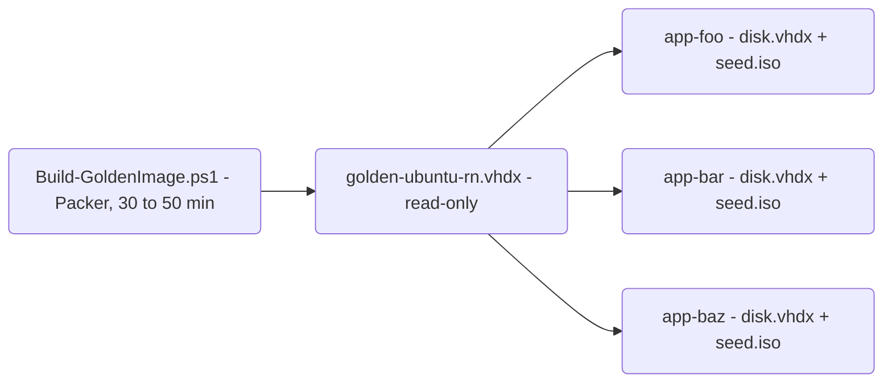

# agent-vm

Disposable Ubuntu VMs on a Windows 11 Hyper-V host, built for running Claude Code agent loops in isolation while
I can still watch what the agent is doing over Remote Desktop.

I run my agents unattended for hours. Doing that on my development machine means every loop has to tiptoe around
my working tree, and a session with `--dangerously-skip-permissions` is a risk to everything on the disk. Giving
each project its own VM removes both problems: the agent can do whatever it wants inside the guest, and the worst
case is that I delete the VM and create a new one in about two minutes.

This repo contains the scripts I use for that. The host is my Ryzen workstation with 64GB of RAM running Windows 11
Pro, and the guests run Ubuntu 24.04 LTS with XFCE. The sibling repo `runner-vm` does the same job with a Windows
guest, for the loops that have to run on Windows.

## How it works

There are two stages. First, Packer builds a golden image once: an unattended Ubuntu install with the desktop, the
toolchains, a browser, the Android emulator and Claude Code already in it. Then every project gets its own VM, which
is only a [differencing disk](https://learn.microsoft.com/en-us/windows-server/virtualization/hyper-v/manage/manage-hyper-v-virtual-hard-disks)
on top of that image plus a small [cloud-init](https://cloudinit.readthedocs.io/en/latest/reference/datasources/nocloud.html)
seed ISO which sets the hostname, the user and the SSH key.



Because the golden image is never modified, a new VM costs seconds of disk work and only grows by what the project
writes. The image name still carries "rn" from where this started: parallel React Native development, with one
Android emulator per project.

Each VM gets:

- A `dev` user with passwordless sudo. SSH accepts my key only, and RDP uses a generated password.
- XFCE and xrdp, set to lossless 32-bit color so I can judge colors and fonts from the Windows desktop.
- Node LTS, Temurin JDK 21 (17 alongside), the Android SDK and an emulator that resumes from a snapshot on KVM.
- VS Code, Google Chrome with the Claude in Chrome extension, Chromium and Playwright with its browsers.
- Claude Code (CLI and VS Code extension) and the GitHub CLI, both logged into nothing.

It is worth mentioning that no credentials are part of the image or the seed ISO. The image is shared by every VM,
and the seed ISO stays attached to the VM and is readable from inside it. `New-AgentVM.ps1` hands the GitHub and
Claude logins to one guest over SSH after it has booted, and only when I ask it to.

## Requirements

- Windows 11 Pro with Hyper-V, and AMD-V or VT-x enabled in the BIOS. The emulator needs nested virtualization.
- An external Hyper-V switch called `DevSwitch`, so each VM gets an address on the LAN.
- [Packer](https://developer.hashicorp.com/packer), `oscdimg` from the Windows ADK, and Android platform-tools.
- An SSH key pair at `~/.ssh/id_ed25519`.
- About 70GB free for the image build, plus space for each VM's own disk.

All commands need an elevated PowerShell, apart from `Get-AgentVMPassword.ps1`.

## Getting started

1. Build the golden image. This runs unattended and takes 30 to 50 minutes, most of it the Android system image
   download and the first boot of the emulator.

   ```powershell
   cd packer
   .\Build-GoldenImage.ps1
   cd ..
   ```

2. Create a VM for a project. It is running about two minutes later, and the script writes an `.rdp` file into
   the current directory.

   ```powershell
   .\New-AgentVM.ps1 -Name app-foo -Repo you/foo
   ```

3. Attach to the agent's tmux session over SSH, or open the `.rdp` file to see the desktop.

   ```powershell
   ssh dev@<vm-ip> -t tmux attach -t agent
   mstsc .\app-foo.rdp
   ```

4. Stop the VM when it is not needed and remove it when the project is done.

   ```powershell
   Stop-VM -Name app-foo
   .\Remove-AgentVM.ps1 -Name app-foo
   ```

The RDP password is printed once when the VM is created. `Get-AgentVMPassword.ps1 -Name app-foo` reads it back, and
`Set-AgentVMPassword.ps1` replaces it.

By default, images and VMs live under `C:\Hyper-V`. To use another drive, set `AGENTVM_ROOT` once, or pass the same
`-Root` to every script.

## Capacity

The emulator, not the agent, decides how many VMs fit on a host. Memory has to be static, because Hyper-V does not
allow dynamic memory together with nested virtualization.

| VM | vCPU | RAM |
| --- | --- | --- |
| With emulator (default) | 4 | 10GB |
| With a physical phone instead (`-DeviceSerial`) | 4 | 6GB |

On my 64GB host, this works out at about five VMs running at the same time after leaving room for Windows. I keep
more than that created, and only start the ones I am working on.

## Documentation

| Document | Content |
| --- | --- |
| [linux-vm-on-windows.md](linux-vm-on-windows.md) | The design and the reasoning behind it |
| [packer/README.md](packer/README.md) | Building the golden image, and what goes wrong |
| [golden-image-contents.md](golden-image-contents.md) | Everything inside the image, and what is left out on purpose |
| [host-scripts.md](host-scripts.md) | Every host script and parameter |
| [runbook.md](runbook.md) | Every command, on the host and in the guest |

## Known limitations

This is work in progress, and some parts are not finished yet:

- The agent's tmux session is started by cloud-init at boot, before anyone has logged in over RDP. I have not yet
  verified that a browser the agent launches from there shows up in the RDP session, and I expect that it does not.
- The RDP password is in plain text on the seed ISO, which the guest can read. The VMs are only reachable on my
  local network, so I accepted this for now, but it is on my list.
- The golden image has a known console password (`devvm`) for debugging a failed build at the Hyper-V console. SSH
  never accepts it. If you build the image yourself, change it as described in [packer/README.md](packer/README.md).
- There is no GPU acceleration in the guests. The emulator renders with SwiftShader, which is fine for app UIs and
  too slow for games.

(Note: Everything here has only been tested on one host, an AMD Ryzen machine with Windows 11 Pro)
